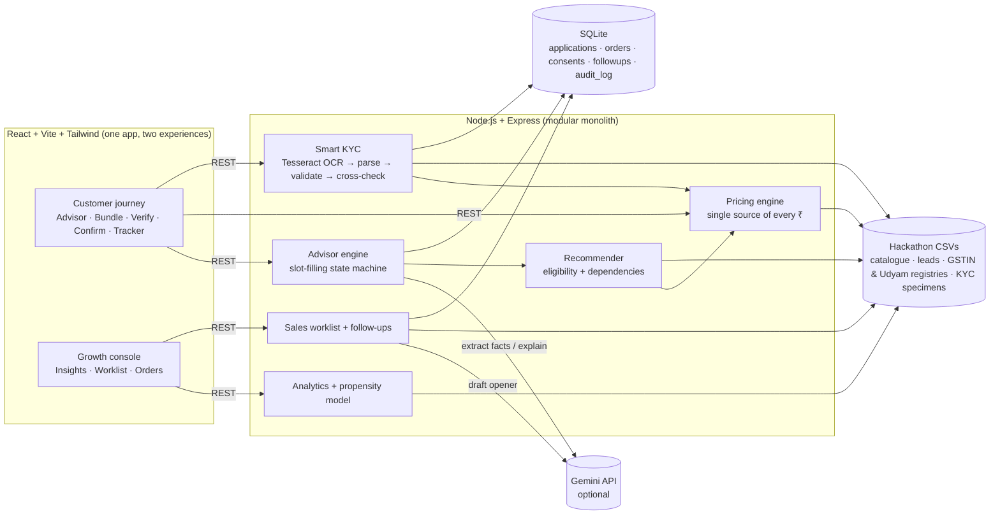

# Udyam Digital — Accel Business

**A small business goes from "tell us about your shop" to a verified order with an installation slot in one sitting — on a phone, in their language.**
Prototype for YTL Hackathon 2026 · Enterprise Track A. Accel Telecom is fictional; all data is the synthetic hackathon pack.

| | |
|---|---|
| Customer site | `http://localhost:5173` — advisor → bundle & price → Smart KYC → confirm → tracker |
| Growth console | `http://localhost:5173/console` — insights, follow-up worklist, digital orders |

---

## 1. Run it

Requirements: Node.js 20+. No native build tools needed (SQLite runs as WebAssembly via `sql.js`).

```bash
cd udyam-digital
npm run setup        # installs server + client dependencies
npm run dev          # API on :8787, web on :5173
```

Production-style single process: `npm start` (builds the client; the API serves it on `http://localhost:8787`).
Clean demo state before a recording: stop the server, `npm run reset`, start again.

The first KYC check downloads Tesseract's English model (~10 MB) once and caches it in `server/.tess-cache/`.

### Environment variables (`server/.env`, see `.env.example`)

| Variable | Required | Purpose |
|---|---|---|
| `GEMINI_API_KEY` | No | Turns on the LLM: free-text understanding in any language, plain-language explanations, regional languages (Marathi, Tamil, Telugu, Kannada, Bengali, Gujarati), AI-drafted sales openers. Without it everything runs on deterministic rules (English + Hindi). |
| `GEMINI_MODEL` | No | Defaults to `gemini-2.5-flash`. |
| `PORT` | No | API port, default `8787`. |

---

## 2. Architecture



**Design rule: the LLM never decides products or prices.** It turns what the owner says into structured facts and turns the deterministic result back into plain language. Recommendation, eligibility, dependencies and pricing are code, so the advisor cannot invent a product or a price, and every scenario is reproducible.

| Layer | Files |
|---|---|
| Data loading & indexes | `server/src/data.js` |
| Advisor (questions, extraction, LLM, fallback) | `server/src/advisor/*` |
| Recommender / eligibility / pricing | `server/src/engine/*` |
| Smart KYC (GSTIN checksum, OCR, verification) | `server/src/kyc/*` |
| Analytics + propensity + routing | `server/src/analytics.js`, `server/src/sales.js` |
| API + persistence | `server/src/index.js`, `server/src/db.js` |
| Customer UI | `client/src/pages/**` |
| Console UI | `client/src/console/*` |
| Design system tokens & components | `client/tailwind.config.js`, `client/src/index.css`, `client/src/components/ui.jsx` |

---

## 3. What is real and what is mocked

| Capability | Status |
|---|---|
| Conversational advisor (EN + HI built in; 6 more languages with the AI key; voice input via the browser's speech API) | **Real** |
| Recommendations from `product_catalogue.csv` — tier, min employees, min sites, GSTIN rule, `requires_one_of` dependencies | **Real**, deterministic |
| Pricing, GST, setup fees, contract term rules, activation time from `typical_install_days` | **Real**, deterministic (pricing rule below) |
| OCR of uploaded documents (Tesseract.js, on the server) | **Real** |
| GSTIN format + mod-36 check digit, OCR look-alike repair (O/0, Z/7, I/J…) | **Real** |
| GSTIN / Udyam "registry lookups" | **Mock** — backed by `mock_gstin_registry.csv` / `mock_udyam_registry.csv`; labelled as mock in the UI |
| DPDP consent capture, versioned notice, withdrawal that erases KYC results | **Real** (stored in SQLite + audit log) |
| E-sign (OTP) and payment | **Mocked** — a checkbox; nothing is charged |
| DigiLocker fetch | Not built — photo upload + registry lookup instead |
| Order tracker, install slot booking, ops "mark installed" | **Real** (SQLite); field engineer system is simulated by the console button |
| Insights, segment economics, propensity score, routing, follow-up updates | **Real**, computed from `smb_leads.csv` |
| AI sales opener | **Real** with the key; template fallback without |

**Pricing rule (documented assumption).** The catalogue gives a min–max band per product. 12-month term = midpoint of the band (rounded up). 24-month term = catalogue floor. Products with `min_contract_months = 24` force a 24-month bundle. Setup = `one_time_setup_inr × qty`, which matches every activated bundle in `smb_leads.csv`. Prices exclude 18% GST, shown separately.

**Smart KYC on the 12 specimen applicants** (it catches the planted problems we found by inspection):

| Applicant | Result |
|---|---|
| K01 | GSTIN **cancelled** in registry; Udyam certificate has a **blank registration number** |
| K02, K04 | GST certificate **too blurred to read** → retake prompt |
| K03, K05, K08, K09, K12 | Verified (K03/K05/K08/K12 need OCR look-alike repair, done via the check digit) |
| K06 | GSTIN printed on the certificate **fails the check digit**; registry has the same business under a different number |
| K07 | Legal name on certificate (**"Shri** Physio Clinic") ≠ registry ("Neelgiri Physio Clinic") — likely altered |
| K10 | Signatory ID is for **Nisha Arora**, the applicant on record is Fatima Menon (LLP — needs an authorisation) |
| K11 | Address proof dated 2025-10-31 — **older than 90 days** (dataset "today" = 2026-07-15) |

---

## 4. Business insights from the data (all computed in-app)

1. **36% of lost leads (1,652 of 4,632) were lost to our own process** — slow or complex quotes, paperwork, unscheduled visits, installation delays. That is the addressable pool for a self-serve journey.
2. **The steepest drop is Needs assessed → Quote accepted (44%)**, driven by "price too high" (414), "competitor cheaper" (207), "quote too complex" (206) and "quote too slow" (179). An instant, plain-language price attacks two of the four directly; the 24-month floor price attacks the other two.
3. **Segment priority:** Professional offices have the best unit economics — 11.1% conversion, ₹10,695 CAC, ₹6,575/month median bundle. **Micro retail is 54% of leads but converts at 4.1% with ₹20,007 CAC against a ₹2,470/month bundle and 22.7% churn** — viable only fully self-serve or via partners.
4. **GSTIN holders activate 4.7× more often (9.6% vs 2.0%).** The advisor asks for the GSTIN, verifies it instantly, and still sells non-GST products to those without one.
5. **Chasing status predicts churn:** 6-month churn rises from 5.9% (1 call) to 27.9% (5 calls); NPS falls from 7.5 to 6.0. The tracker is a retention feature, not only a support cost saver.
6. **Referrals convert 14.8% at ₹4,099 CAC; field sales 7.3% at ₹24,335.** Field sales should focus on multi-site and manufacturing accounts (bundles of ₹16k–28k/month).

**Recommended bundles by segment** (what the recommender produces by default; all eligibility-checked):

| Segment | Default bundle | Typical price | Term |
|---|---|---|---|
| Micro retail & services | Biz Fibre 100 + 1–2 Postpaid 299 + Cloud POS (+ CCTV / WhatsApp if GST-active) | ₹2,546–3,044/mo | 12 mo |
| Professional offices | Biz Fibre 300 (1G in tier-1 for 15+ staff) + Postpaid 599 + Cloud Email + Endpoint Security + Backup | ₹4,000–7,000/mo | 12 mo |
| Multi-site | Fibre per site + failover + POS + CCTV + SD-WAN (3+ sites) | ₹20k–30k/mo | 24 mo |
| Manufacturers | Leased line (10+ staff, GST) + Postpaid 599 + email + security + CCTV + machine IoT | ₹15k+/mo | 24 mo |

**Role of the field force and partners (Q4):** every dropped lead is routed by rule — *Digital nudge* (friction reasons, micro/professional), *Channel partner* (partner-sourced leads keep their partner), *Inside sales* (price objections, document mismatches), *Field sales* (multi-site/manufacturing, installation escalations). Digital journeys that stall appear in the same worklist with the exact failure reason, so sales picks up where the advisor stopped instead of starting again.

**Success metrics & 12-month targets:** lead→activation 7.4% → 12% · lead→activation time 17.6 days → ≤ 7 · CAC ₹15,053 → ≤ ₹6,000 · status chases 3 → < 1 · 6-month churn 15.2% → ≤ 10%.

---

## 5. Three-minute demo script

| Time | Screen | Say / do |
|---|---|---|
| 0:00 | Home | "Today an SMB waits 17.6 days and calls 3 times. Only 7% of leads activate." Click **Start with the advisor**. |
| 0:15 | Advisor | Type: *"I run an insurance agency in Visakhapatnam with 8 people, need business email and virus protection."* The profile panel fills from one sentence. Tap **Home broadband**, confirm needs, enter GSTIN `37LDYXK0296F1ZB` → registry lookup shows Active. |
| 0:50 | Recommendation | Point at the plain-language reasons and the single monthly price. "Products and prices come from the catalogue engine — the AI can't invent them." |
| 1:05 | Bundle | Swap connection, toggle an add-on, switch to **24 months** → savings appear. Open **Not available for you** to show honest eligibility reasons. |
| 1:25 | Verify | Consent screen (DPDP: what, why, how long, rights). Pick sample **K01** → *Check*: cancelled GSTIN + blank Udyam number flagged. Switch to **K09** → verified in seconds. |
| 2:05 | Confirm | Pick a date and window, mobile number, e-sign → **Place order**. |
| 2:20 | Tracker | Live timeline, per-product readiness, WhatsApp updates. "No calls needed." |
| 2:30 | Console | Insights: 36% of drops are our process; GSTIN 4.7×; chases → churn. Worklist: filter **Digital**, open a lead → propensity drivers → **Draft** an opener. **Digital orders** → *Mark installed* → tracker shows **Activated**. |

Optional (judges' scenarios): Hindi — choose हिन्दी on the home page and type *"मेरी किराना दुकान है जयपुर में, 2 लोग काम करते हैं"*; tier-2 + small team asking for a leased line and 1 Gbps → both shown as unavailable with reasons.

---

## 6. Privacy & security choices (summary — see `docs/PRIVACY.md`)

Consent before any document is read (versioned notice, separate optional purposes); images processed in memory and never stored; only check results and masked identifiers persisted; GSTIN/ID/consumer numbers masked in UI and logs; consent withdrawal erases verification data; audit log of consent, lookups, KYC outcomes and orders; LLM receives business facts only — never document images or ID numbers.
